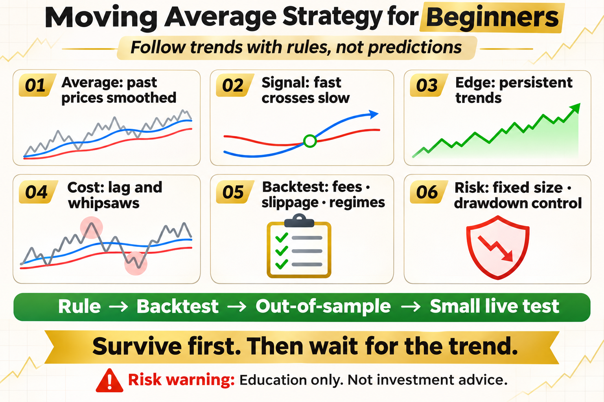

# Moving Average Strategy for Beginners

Many beginners start quant trading with moving averages. Two lines cross and it looks like a complete strategy. But the real value of a moving average is not predicting tomorrow. It is applying one consistent rule to identify a trend that has already begun.

This article does not offer a magic parameter. It answers three practical questions: what the tool measures, where it may work, and how risk should be written into the rule.

## 1. What Is a Moving Average?

A moving average is the average closing price over a chosen lookback window. A 5-period average reacts quickly, while a 20- or 60-period average is smoother. Short windows respond faster but contain more noise; long windows filter noise but react later.

## 2. The Basic Trading Logic

A common rule observes or enters when a short average crosses above a long average, then exits when it crosses below. Another rule holds while price stays above one average. The key is to define the window, entry, exit, and position size before testing.

## 3. Where the Return Comes From

The strategy tries to capture persistent trends, not every small fluctuation. A long trend may pay for several small losses. In a sideways market, repeated crossovers can create a chain of whipsaws.

## 4. What a Backtest Must Include

Include fees, slippage, and a realistic assumption that the trade occurs after the signal. Test multiple years, assets, and timeframes instead of selecting one attractive period.

## 5. Common Beginner Mistakes

Heavy sizing after one bullish crossover, endless parameter tuning, and ignoring range-bound markets all create false confidence. A moving average is only a signal; it is not risk management.

## 6. A Practical Exercise

Test 20- and 60-day averages on daily Bitcoin data. Use spot-only exposure and fixed position size. Record return, maximum drawdown, trade count, and holding time, then compare the result with buy and hold.

## The Deeper Principle: An Indicator Is Not an Edge by Itself

An indicator is a transformation of price, volatility, or trading data. A durable process needs a clear hypothesis, repeatable execution, realistic costs, and controlled risk. Every attractive signal should be tested across regimes, out of sample, and in a small live or simulated environment.

## What an Ordinary Beginner Should Do

- Write the rule in one unambiguous sentence.
- Validate with spot exposure or simulation before considering leverage.
- Include fees, slippage, and imperfect fills.
- Limit risk per trade and record drawdown and losing streaks.
- Review which market regimes suit the strategy instead of changing parameters after every loss.

## Conclusion

A moving average does not predict the future; it gives you a disciplined way to follow an emerging trend.

The goal of learning strategies is not to find an indicator that never fails. It is to understand when it works, how it fails, and how the account survives until the next opportunity.

> Risk warning: This article is for trading education only and does not constitute investment advice. Digital assets are highly volatile. Historical backtests do not guarantee future returns, and live risk should be evaluated carefully.
