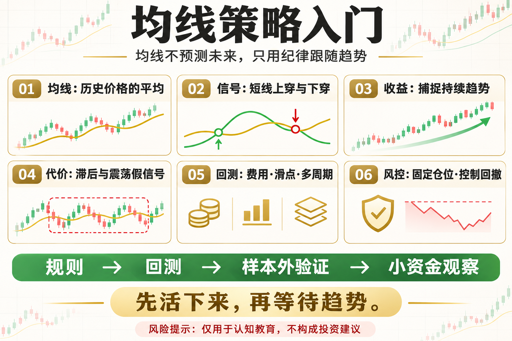

# 均线策略入门

很多新手第一次接触量化，都会从均线开始。两条线一交叉，看起来就像一个完整策略。但均线真正的价值，不是预测明天涨跌，而是用统一规则识别已经形成的趋势。

这篇文章不提供神奇参数，而是回答三个问题：这个工具在测量什么、它在什么环境可能有效、你怎样把风险写进规则。

## 一、均线到底是什么

均线是过去一段时间收盘价的平均值。5 日均线更敏感，20 日或 60 日均线更平滑。周期越短，反应越快，噪声也越多；周期越长，信号更慢，但更能过滤短期波动。

## 二、最基础的交易逻辑

常见做法是让短期均线上穿长期均线时进入观察或做多，下穿时退出。另一种做法是价格站上均线后持有，跌破后离场。规则并不神秘，重点是提前定义周期、入场、退出和仓位。

## 三、均线策略赚什么钱

它赚的是持续趋势的钱，而不是每一次小波动。趋势走得越远，策略越有机会覆盖此前的小亏损；市场反复横盘时，交叉信号会频繁打脸。

## 四、回测时必须加入什么

至少加入手续费、滑点和下一根 K 线成交假设。还要检查不同年份、不同币种和不同周期，不能只挑一段漂亮行情。

## 五、新手最容易犯的错

看到一次金叉就重仓、不断修改周期追求完美、忽略震荡市和交易成本，都会把简单规则变成过拟合。均线只是信号，不是风险管理。

## 六、一个可执行的练习

先用日线 BTC 数据测试 20 日与 60 日均线。只做现货方向，单次仓位固定，记录收益、最大回撤、交易次数和持仓时间，再与简单持有比较。

## 底层本质：指标不是优势本身

指标只是对价格、波动或成交数据的重新表达。真正的策略优势来自明确假设、可重复执行、合理成本和受控风险。任何看起来简单有效的信号，都要经历多阶段数据、样本外验证和小资金观察。

## 普通人该怎么做

- 先把规则写成一句没有歧义的话。
- 先用现货或模拟环境验证，不急着加杠杆。
- 把手续费、滑点和无法成交纳入结果。
- 限制单次风险，记录最大回撤与连续亏损。
- 定期复盘策略适用的市场状态，而不是亏损后临时改参数。

## 结语

均线不负责预测未来，它只负责让你用纪律跟随已经出现的趋势。

策略学习的目标，不是找到永不失效的指标，而是理解它何时有效、何时会受伤，以及账户如何活到下一次机会。

> 风险提示：本文仅用于交易认知与技术教育，不构成任何投资建议。数字资产波动较大，历史回测不代表未来收益，实盘前应充分评估风险。
