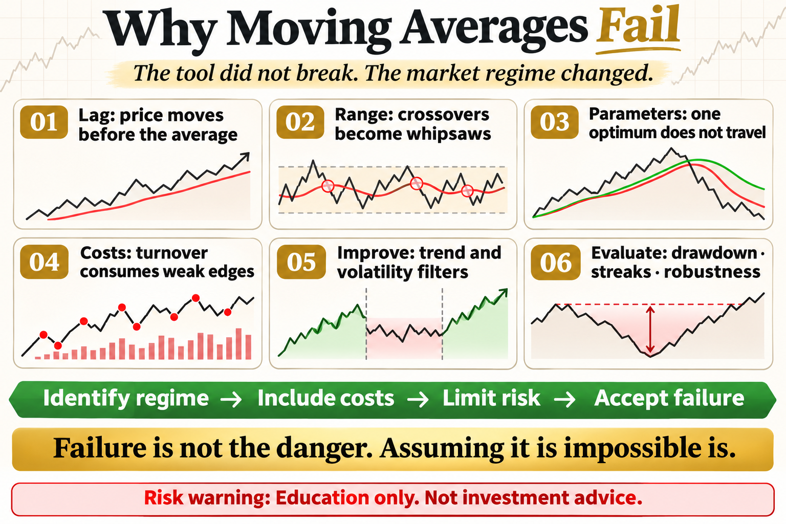

# Why Moving Averages Fail

Moving averages look excellent on a clean trending chart, yet they can produce repeated losses in live trading. The indicator did not suddenly break. The problem is treating a tool designed for one market regime as an all-weather answer.

This article does not offer a magic parameter. It answers three practical questions: what the tool measures, where it may work, and how risk should be written into the rule.

## 1. Moving Averages Are Inherently Late

A moving average is calculated from past prices, so price must move before the line can turn. Long windows confirm slowly; short windows react faster but trigger more noise. Lag is the cost of filtering, not a software bug.

## 2. Sideways Markets Create False Signals

When price repeatedly crosses the average, the strategy buys and sells over and over. Each loss may be small, but fees, slippage, and consecutive whipsaws can build a meaningful drawdown.

## 3. Parameters Depend on the Regime

A 20/60 combination that worked in one period may fail on another asset, timeframe, or volatility regime. Deploying the historical optimum often means chasing a structure that has already disappeared.

## 4. Costs Consume a Weak Edge

Frequent crossover strategies are sensitive to fees and slippage. A frictionless backtest filled at the closing price usually overstates what can be achieved in practice.

## 5. Reducing the Damage

Trend-strength or volatility filters, minimum holding periods, and smaller positions may reduce whipsaws. No filter removes losses; it only changes the probability and trade-off.

## 6. Evaluating the Rule Correctly

Do not look only at win rate and total return. Review maximum drawdown, losing streaks, turnover, regime performance, and whether small parameter changes produce similar results.

## The Deeper Principle: An Indicator Is Not an Edge by Itself

An indicator is a transformation of price, volatility, or trading data. A durable process needs a clear hypothesis, repeatable execution, realistic costs, and controlled risk. Every attractive signal should be tested across regimes, out of sample, and in a small live or simulated environment.

## What an Ordinary Beginner Should Do

- Write the rule in one unambiguous sentence.
- Validate with spot exposure or simulation before considering leverage.
- Include fees, slippage, and imperfect fills.
- Limit risk per trade and record drawdown and losing streaks.
- Review which market regimes suit the strategy instead of changing parameters after every loss.

## Conclusion

Strategy failure is not the danger; treating failure as impossible is.

The goal of learning strategies is not to find an indicator that never fails. It is to understand when it works, how it fails, and how the account survives until the next opportunity.

> Risk warning: This article is for trading education only and does not constitute investment advice. Digital assets are highly volatile. Historical backtests do not guarantee future returns, and live risk should be evaluated carefully.
