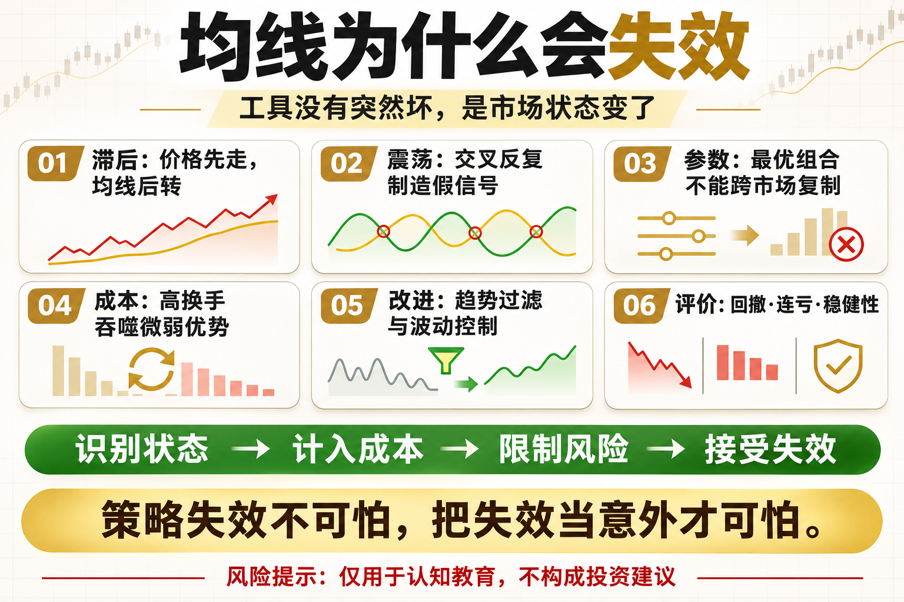

# 均线为什么会失效

均线策略最容易让人误解的地方，是它在趋势图上非常漂亮，在真实交易中却经常连续止损。不是均线突然坏了，而是你把只适合某种市场状态的工具，当成了全天候答案。

这篇文章不提供神奇参数，而是回答三个问题：这个工具在测量什么、它在什么环境可能有效、你怎样把风险写进规则。

## 一、均线天生滞后

均线由历史价格计算，必须等价格先走出来才会转向。参数越长，确认越慢；参数越短，虽然更快，却更容易被噪声触发。滞后不是程序错误，而是过滤噪声的代价。

## 二、震荡市会制造假信号

价格围绕均线上下穿越时，策略会不断买入又卖出。每次亏损可能不大，但手续费、滑点和连续小亏会累积成明显回撤。

## 三、参数会随市场变化

在某段行情有效的 20/60 参数，不代表换一个币种、周期或波动环境仍然有效。用历史最优参数直接上实盘，往往是在追逐已经结束的结构。

## 四、成本会吃掉微弱优势

交叉策略交易越频繁，对手续费和滑点越敏感。回测若按收盘价无摩擦成交，得到的收益通常高于真实可实现结果。

## 五、如何减少失效伤害

可以加入趋势强度或波动过滤、设置最短持有期、控制仓位，并在震荡环境降低交易频率。但任何过滤器都只能改善概率，不能消灭亏损。

## 六、正确评价一条均线

不要只问胜率和总收益。还要看最大回撤、连续亏损、换手率、不同市场阶段表现，以及参数轻微变化后结果是否仍然稳定。

## 底层本质：指标不是优势本身

指标只是对价格、波动或成交数据的重新表达。真正的策略优势来自明确假设、可重复执行、合理成本和受控风险。任何看起来简单有效的信号，都要经历多阶段数据、样本外验证和小资金观察。

## 普通人该怎么做

- 先把规则写成一句没有歧义的话。
- 先用现货或模拟环境验证，不急着加杠杆。
- 把手续费、滑点和无法成交纳入结果。
- 限制单次风险，记录最大回撤与连续亏损。
- 定期复盘策略适用的市场状态，而不是亏损后临时改参数。

## 结语

策略失效不可怕，把失效当成意外才可怕。

策略学习的目标，不是找到永不失效的指标，而是理解它何时有效、何时会受伤，以及账户如何活到下一次机会。

> 风险提示：本文仅用于交易认知与技术教育，不构成任何投资建议。数字资产波动较大，历史回测不代表未来收益，实盘前应充分评估风险。
