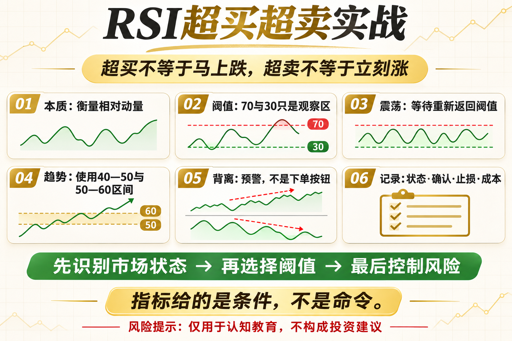

# RSI超买超卖实战

RSI 超过 70 就卖，低于 30 就买，是技术指标里最常见的口号之一。问题是，强趋势里 RSI 可以长时间停在高位或低位。超买不等于马上下跌，超卖也不等于立刻反弹。

这篇文章不提供神奇参数，而是回答三个问题：这个工具在测量什么、它在什么环境可能有效、你怎样把风险写进规则。

## 一、RSI测量的是什么

RSI 比较一段时间内上涨与下跌的相对强度，常用周期是 14。它反映动量的位置，而不是资产的绝对便宜或昂贵。

## 二、70和30不是开关

阈值只是观察区。趋势强时，高位 RSI 可能代表买盘持续；下跌加速时，低位 RSI 可能只是弱势继续。直接逆势交易，容易接飞刀。

## 三、均值回归的用法

在明确震荡区间内，可以等待 RSI 进入极端区后重新返回阈值，再配合价格支撑、止损和目标位。确认返回通常比第一次触线更稳健。

## 四、趋势中的用法

上升趋势里可关注 RSI 回落到 40—50 后重新转强，而不是等待 30；下降趋势里则关注 50—60 附近的反弹失败。阈值应服务市场结构。

## 五、背离不能单独下单

价格创新高而 RSI 未创新高，叫顶背离；反之为底背离。背离说明动量变化，但可能持续很久，必须结合结构突破和风险控制。

## 六、实战记录清单

记录 RSI 周期、阈值、市场状态、入场确认、止损、持有时间和成本。分别统计趋势与震荡阶段，才能知道策略究竟在哪种环境有效。

## 底层本质：指标不是优势本身

指标只是对价格、波动或成交数据的重新表达。真正的策略优势来自明确假设、可重复执行、合理成本和受控风险。任何看起来简单有效的信号，都要经历多阶段数据、样本外验证和小资金观察。

## 普通人该怎么做

- 先把规则写成一句没有歧义的话。
- 先用现货或模拟环境验证，不急着加杠杆。
- 把手续费、滑点和无法成交纳入结果。
- 限制单次风险，记录最大回撤与连续亏损。
- 定期复盘策略适用的市场状态，而不是亏损后临时改参数。

## 结语

指标给你的是条件，不是命令；交易仍然需要市场结构和风险边界。

策略学习的目标，不是找到永不失效的指标，而是理解它何时有效、何时会受伤，以及账户如何活到下一次机会。

> 风险提示：本文仅用于交易认知与技术教育，不构成任何投资建议。数字资产波动较大，历史回测不代表未来收益，实盘前应充分评估风险。
