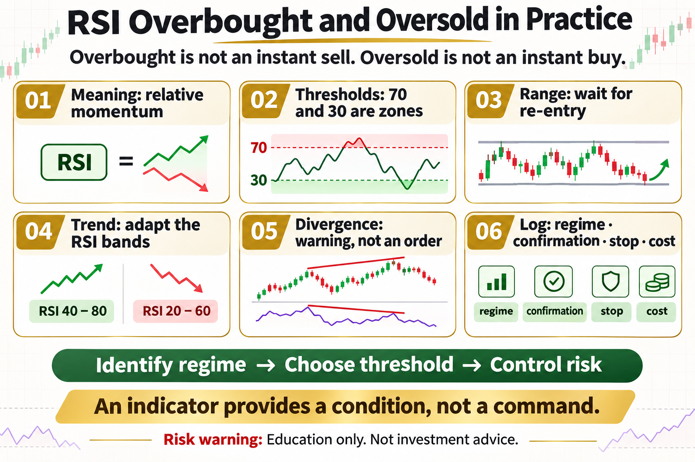

# RSI Overbought and Oversold in Practice

“Sell above 70 and buy below 30” is one of the most repeated RSI rules. The problem is that RSI can remain high or low for a long time during a strong trend. Overbought does not mean an immediate fall, and oversold does not guarantee a rebound.

This article does not offer a magic parameter. It answers three practical questions: what the tool measures, where it may work, and how risk should be written into the rule.

## 1. What RSI Measures

RSI compares the relative strength of recent gains and losses, commonly over 14 periods. It describes momentum, not whether an asset is absolutely cheap or expensive.

## 2. 70 and 30 Are Not Switches

The thresholds are observation zones. High RSI in a strong uptrend can signal persistent demand; low RSI during an accelerating decline may simply confirm weakness. Blindly fading either condition can be dangerous.

## 3. Mean-Reversion Use

Inside a well-defined range, wait for RSI to enter an extreme and then move back through the threshold. Combine that confirmation with price support, a stop, and a target.

## 4. Trend-Aware Use

In an uptrend, RSI may pull back toward 40–50 and turn higher without reaching 30. In a downtrend, rebounds may fail around 50–60. Thresholds should adapt to market structure.

## 5. Divergence Is Not a Standalone Order

When price makes a new high but RSI does not, bearish divergence appears; the reverse is bullish divergence. It shows a momentum change, but it may persist, so wait for structure and control risk.

## 6. A Practical Log

Record the RSI window, threshold, market regime, entry confirmation, stop, holding time, and costs. Separate trending and ranging periods to learn where the rule actually works.

## The Deeper Principle: An Indicator Is Not an Edge by Itself

An indicator is a transformation of price, volatility, or trading data. A durable process needs a clear hypothesis, repeatable execution, realistic costs, and controlled risk. Every attractive signal should be tested across regimes, out of sample, and in a small live or simulated environment.

## What an Ordinary Beginner Should Do

- Write the rule in one unambiguous sentence.
- Validate with spot exposure or simulation before considering leverage.
- Include fees, slippage, and imperfect fills.
- Limit risk per trade and record drawdown and losing streaks.
- Review which market regimes suit the strategy instead of changing parameters after every loss.

## Conclusion

An indicator provides a condition, not a command; every trade still needs structure and a risk boundary.

The goal of learning strategies is not to find an indicator that never fails. It is to understand when it works, how it fails, and how the account survives until the next opportunity.

> Risk warning: This article is for trading education only and does not constitute investment advice. Digital assets are highly volatile. Historical backtests do not guarantee future returns, and live risk should be evaluated carefully.
