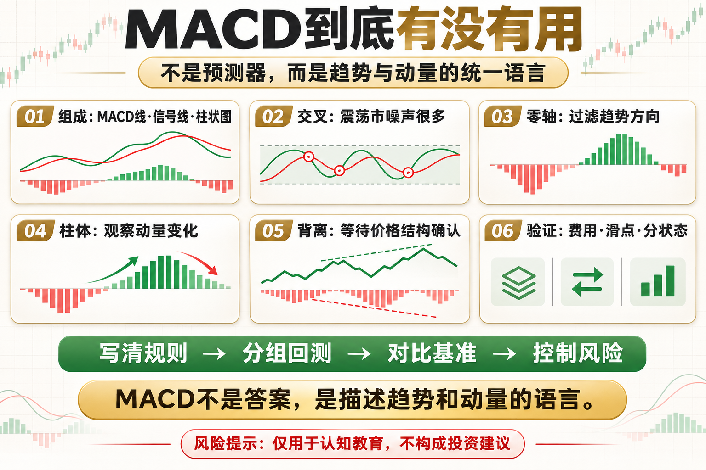

# MACD到底有没有用

有人把 MACD 当成万能指标，也有人说它完全滞后、毫无价值。两种说法都过头了。MACD 的作用不是提前知道价格，而是把趋势方向、动量变化和交叉信号压缩到一个统一框架里。

这篇文章不提供神奇参数，而是回答三个问题：这个工具在测量什么、它在什么环境可能有效、你怎样把风险写进规则。

## 一、MACD由什么组成

MACD 线来自快慢指数均线之差，信号线是 MACD 的平滑值，柱状图表示两者距离。它本质上仍然来自价格，不是独立信息源。

## 二、金叉死叉为什么不够

每次交叉都交易，会在震荡市产生大量噪声。交叉发生在零轴哪一侧、价格是否有趋势、成交成本多高，都会改变结果。

## 三、零轴与趋势过滤

MACD 位于零轴上方通常表示中期动量偏强，下方则偏弱。用零轴过滤交叉，可以减少逆势信号，但也会更晚。

## 四、柱状图看动量变化

柱体缩短说明两条线距离收窄，动量正在变化，但不等于价格立刻反转。它适合做预警，不适合单独做入场按钮。

## 五、背离的正确理解

MACD 背离提示价格与动量不同步。它能提醒趋势可能衰减，却不能给出精确时间，必须等待价格结构确认。

## 六、如何验证是否有用

把规则写清楚，加入费用和滑点，按趋势与震荡分组，再与简单均线或持有基准比较。能否形成稳定流程，比图上看起来准不准更重要。

## 底层本质：指标不是优势本身

指标只是对价格、波动或成交数据的重新表达。真正的策略优势来自明确假设、可重复执行、合理成本和受控风险。任何看起来简单有效的信号，都要经历多阶段数据、样本外验证和小资金观察。

## 普通人该怎么做

- 先把规则写成一句没有歧义的话。
- 先用现货或模拟环境验证，不急着加杠杆。
- 把手续费、滑点和无法成交纳入结果。
- 限制单次风险，记录最大回撤与连续亏损。
- 定期复盘策略适用的市场状态，而不是亏损后临时改参数。

## 结语

MACD不是答案，它是把趋势和动量说清楚的一种语言。

策略学习的目标，不是找到永不失效的指标，而是理解它何时有效、何时会受伤，以及账户如何活到下一次机会。

> 风险提示：本文仅用于交易认知与技术教育，不构成任何投资建议。数字资产波动较大，历史回测不代表未来收益，实盘前应充分评估风险。
