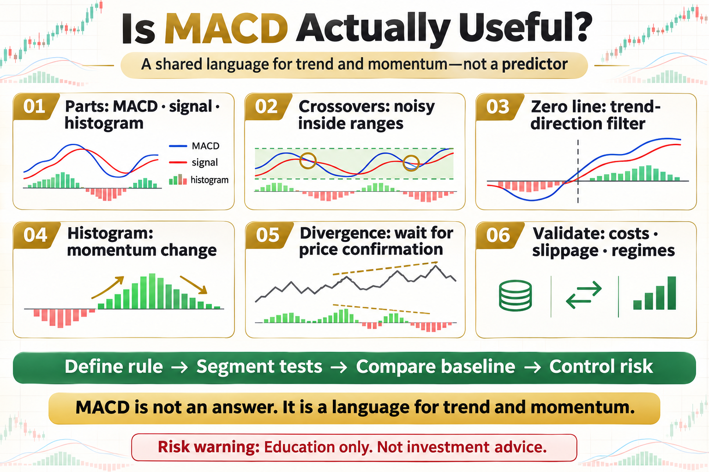

# Is MACD Actually Useful?

Some traders treat MACD as universal, while others dismiss it as useless lag. Both views go too far. MACD does not know the future; it compresses trend direction, momentum change, and crossover information into one framework.

This article does not offer a magic parameter. It answers three practical questions: what the tool measures, where it may work, and how risk should be written into the rule.

## 1. What MACD Contains

The MACD line is the difference between fast and slow exponential averages. The signal line smooths MACD, and the histogram shows the distance between them. All of it is derived from price.

## 2. Why Crossovers Are Not Enough

Trading every crossover creates noise in a range. The side of the zero line, the surrounding price trend, and transaction costs all change the outcome.

## 3. The Zero Line as a Filter

MACD above zero usually indicates stronger medium-term momentum, while below zero indicates weakness. A zero-line filter reduces countertrend signals but also delays entries.

## 4. Reading the Histogram

A shrinking histogram means the two lines are converging and momentum is changing. It does not mean price must reverse immediately, so it works better as an alert than an order button.

## 5. Understanding Divergence

MACD divergence shows that price and momentum are no longer moving together. It may warn of trend decay, but it does not provide exact timing; price structure still needs to confirm.

## 6. Testing Whether It Helps

Define the rule, include fees and slippage, separate trends from ranges, and compare with a simple moving-average or buy-and-hold baseline. A stable process matters more than a convincing chart.

## The Deeper Principle: An Indicator Is Not an Edge by Itself

An indicator is a transformation of price, volatility, or trading data. A durable process needs a clear hypothesis, repeatable execution, realistic costs, and controlled risk. Every attractive signal should be tested across regimes, out of sample, and in a small live or simulated environment.

## What an Ordinary Beginner Should Do

- Write the rule in one unambiguous sentence.
- Validate with spot exposure or simulation before considering leverage.
- Include fees, slippage, and imperfect fills.
- Limit risk per trade and record drawdown and losing streaks.
- Review which market regimes suit the strategy instead of changing parameters after every loss.

## Conclusion

MACD is not an answer; it is a language for describing trend and momentum.

The goal of learning strategies is not to find an indicator that never fails. It is to understand when it works, how it fails, and how the account survives until the next opportunity.

> Risk warning: This article is for trading education only and does not constitute investment advice. Digital assets are highly volatile. Historical backtests do not guarantee future returns, and live risk should be evaluated carefully.
