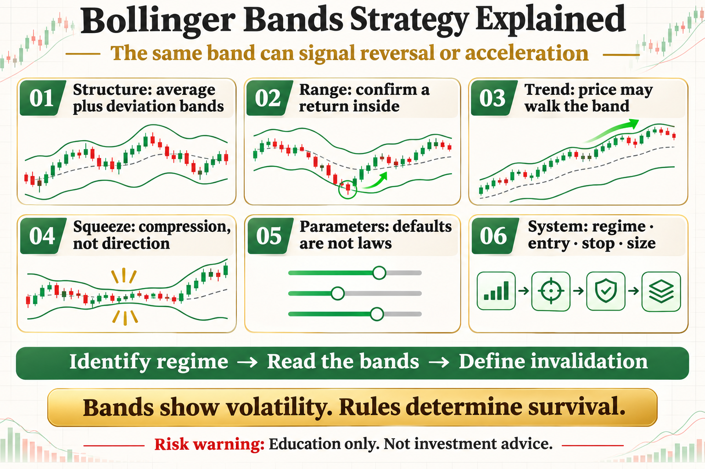

# Bollinger Bands Strategy Explained

Selling the upper band and buying the lower band sounds intuitive. But Bollinger Bands describe price location relative to an average and changing volatility. The same band can mark reversal in a range or acceleration in a trend.

This article does not offer a magic parameter. It answers three practical questions: what the tool measures, where it may work, and how risk should be written into the rule.

## 1. What the Three Lines Mean

The middle band is usually a 20-period average. Upper and lower bands sit a chosen number of standard deviations away. Bands expand as volatility rises and contract as it falls.

## 2. Mean Reversion in a Range

In a clear range, watch for price to touch an outer band and then return inside. The middle band or opposite side can become a target, but an invalidation point is essential if the range becomes a trend.

## 3. Walking the Band in a Trend

During a strong trend, price can repeatedly stay near one outer band. A touch is not automatically a reversal; it may confirm strength. Fading it blindly can produce repeated losses.

## 4. Squeezes and Breakouts

Historically narrow bandwidth indicates volatility compression, not breakout direction. Wait for the break and evidence of follow-through before applying a trend rule.

## 5. Parameters and Timeframes

Twenty periods and two standard deviations are common defaults, not laws. Test robustness across assets and timeframes instead of trusting one optimum.

## 6. What a Complete Strategy Needs

Define the regime, trigger, confirmation, stop, position size, exit, and cost assumptions. Bands provide context; risk control determines survival.

## The Deeper Principle: An Indicator Is Not an Edge by Itself

An indicator is a transformation of price, volatility, or trading data. A durable process needs a clear hypothesis, repeatable execution, realistic costs, and controlled risk. Every attractive signal should be tested across regimes, out of sample, and in a small live or simulated environment.

## What an Ordinary Beginner Should Do

- Write the rule in one unambiguous sentence.
- Validate with spot exposure or simulation before considering leverage.
- Include fees, slippage, and imperfect fills.
- Limit risk per trade and record drawdown and losing streaks.
- Review which market regimes suit the strategy instead of changing parameters after every loss.

## Conclusion

The bands show where volatility is; your rules determine whether you survive it.

The goal of learning strategies is not to find an indicator that never fails. It is to understand when it works, how it fails, and how the account survives until the next opportunity.

> Risk warning: This article is for trading education only and does not constitute investment advice. Digital assets are highly volatile. Historical backtests do not guarantee future returns, and live risk should be evaluated carefully.
