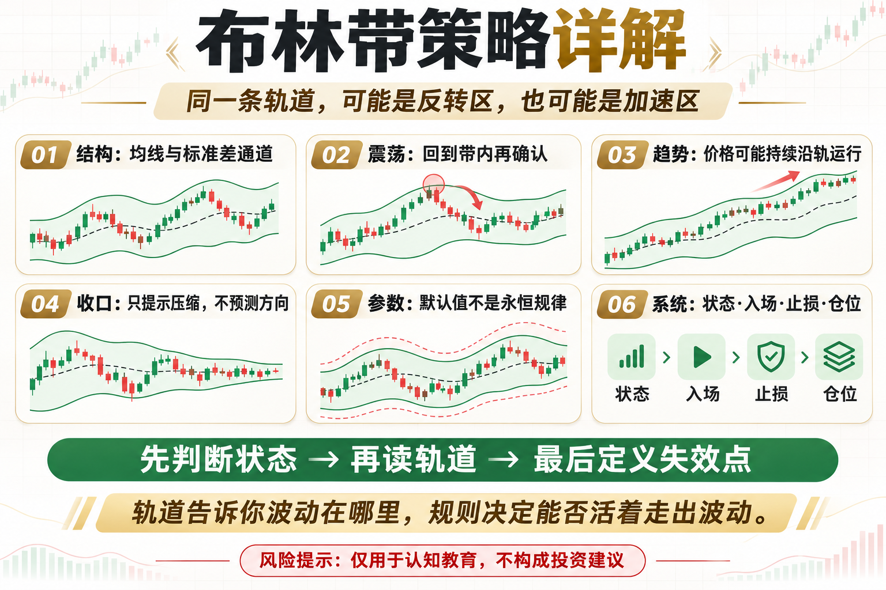

# 布林带策略详解

价格碰到上轨就卖、碰到下轨就买，看起来很直观。但布林带真正描述的是价格相对均线的位置和波动率变化。忽略市场状态，同一条轨道既可能是反转区，也可能是趋势加速区。

这篇文章不提供神奇参数，而是回答三个问题：这个工具在测量什么、它在什么环境可能有效、你怎样把风险写进规则。

## 一、三条线代表什么

中轨通常是 20 周期均线，上下轨是在中轨两侧加减若干倍标准差。波动变大，带宽扩张；波动收缩，带宽变窄。

## 二、震荡市的均值回归

当市场有清晰区间时，可关注价格触及外轨后重新回到带内，并以中轨或区间另一侧作为目标。必须设置失效点，防止区间演变成趋势。

## 三、趋势市的沿轨运行

强趋势中，价格会连续贴着上轨或下轨走。触轨不是天然反转信号，反而可能说明趋势强。逆势摸顶抄底容易连续亏损。

## 四、布林收口与突破

带宽处于历史低位表示波动压缩，但不能告诉你突破方向。应等待价格突破、成交活跃和后续延续，再制定跟随规则。

## 五、参数与周期

20 周期、2 倍标准差只是常见默认值。不同币种和周期需要稳健性测试，不能把最优参数当作永恒规律。

## 六、完整策略应包含什么

定义市场状态、触发条件、确认条件、止损、仓位、退出和成本。布林带提供框架，真正决定生存的是风险控制。

## 底层本质：指标不是优势本身

指标只是对价格、波动或成交数据的重新表达。真正的策略优势来自明确假设、可重复执行、合理成本和受控风险。任何看起来简单有效的信号，都要经历多阶段数据、样本外验证和小资金观察。

## 普通人该怎么做

- 先把规则写成一句没有歧义的话。
- 先用现货或模拟环境验证，不急着加杠杆。
- 把手续费、滑点和无法成交纳入结果。
- 限制单次风险，记录最大回撤与连续亏损。
- 定期复盘策略适用的市场状态，而不是亏损后临时改参数。

## 结语

轨道告诉你波动在哪里，规则决定你能不能活着走出波动。

策略学习的目标，不是找到永不失效的指标，而是理解它何时有效、何时会受伤，以及账户如何活到下一次机会。

> 风险提示：本文仅用于交易认知与技术教育，不构成任何投资建议。数字资产波动较大，历史回测不代表未来收益，实盘前应充分评估风险。
