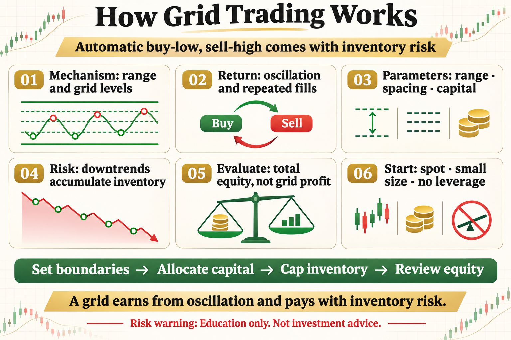

# How Grid Trading Works

Grid trading is often marketed as automatic buying low and selling high. That description omits the key condition: price must oscillate inside a tolerable range. A grid is not a money printer; it exchanges inventory risk for range-trading income.

This article does not offer a magic parameter. It answers three practical questions: what the tool measures, where it may work, and how risk should be written into the rule.

## 1. How a Grid Operates

Set an upper price, lower price, and number of grid levels. The system buys in steps as price falls and sells matching inventory as price rises, attempting to capture the distance between levels.

## 2. Where the Return Comes From

Return comes from oscillation and repeated fills, not directional prediction. Too little movement cannot cover costs, while a strong one-way move pushes inventory toward one side.

## 3. Core Parameters

The range defines the boundary, spacing sets gross profit and frequency, and capital allocation determines how many buys can be carried. Denser grids trade more but pay more fees.

## 4. Inventory Risk

A persistent decline makes the grid accumulate more inventory and unrealized loss. A persistent rise may sell the asset too early. Many small realized gains can be overwhelmed by one large inventory loss.

## 5. What a Backtest Must Show

Measure total equity, ending inventory, maximum drawdown, capital utilization, and transaction costs. Reporting completed-grid profit alone hides unrealized risk.

## 6. A Safer Beginner Start

Use simulation or small spot positions without leverage. Define the range, maximum inventory, shutdown condition, and review schedule, then evaluate the net result after costs.

## The Deeper Principle: An Indicator Is Not an Edge by Itself

An indicator is a transformation of price, volatility, or trading data. A durable process needs a clear hypothesis, repeatable execution, realistic costs, and controlled risk. Every attractive signal should be tested across regimes, out of sample, and in a small live or simulated environment.

## What an Ordinary Beginner Should Do

- Write the rule in one unambiguous sentence.
- Validate with spot exposure or simulation before considering leverage.
- Include fees, slippage, and imperfect fills.
- Limit risk per trade and record drawdown and losing streaks.
- Review which market regimes suit the strategy instead of changing parameters after every loss.

## Conclusion

A grid earns from oscillation and pays for it with inventory risk when price leaves the range.

The goal of learning strategies is not to find an indicator that never fails. It is to understand when it works, how it fails, and how the account survives until the next opportunity.

> Risk warning: This article is for trading education only and does not constitute investment advice. Digital assets are highly volatile. Historical backtests do not guarantee future returns, and live risk should be evaluated carefully.
