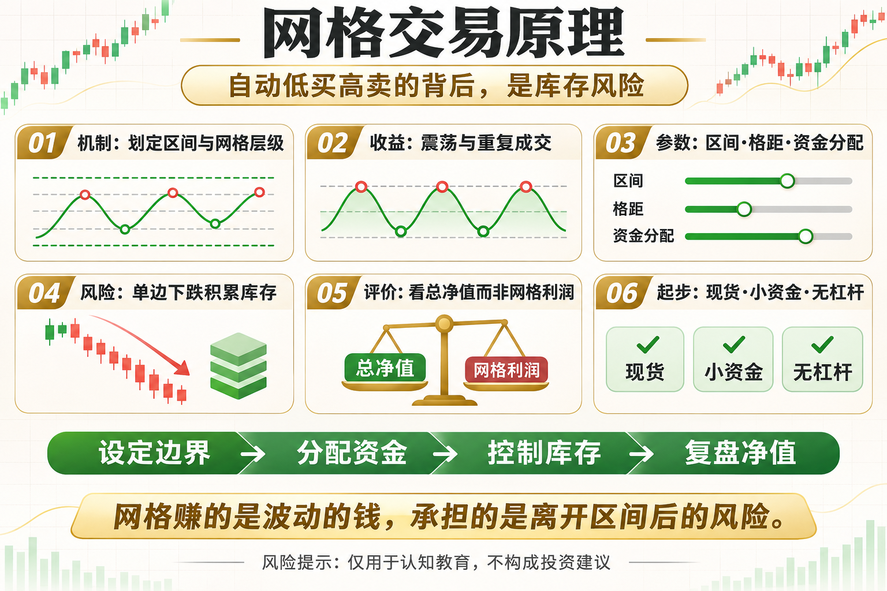

# 网格交易原理

网格交易常被包装成“自动低买高卖”。这句话没有错，却省略了最重要的前提：价格要在可承受的区间内来回波动。网格不是印钞机，而是用库存风险换取震荡收益。

这篇文章不提供神奇参数，而是回答三个问题：这个工具在测量什么、它在什么环境可能有效、你怎样把风险写进规则。

## 一、网格如何工作

先设定价格上限、下限和网格数量。价格下跌穿过一格就分批买入，上涨穿过一格就卖出对应仓位，试图反复赚取格间价差。

## 二、收益来自哪里

收益来自震荡与成交次数，而不是准确预测方向。波动太小覆盖不了成本，单边波动太大又会让库存持续偏向一侧。

## 三、核心参数

区间决定策略边界，格距决定单格毛利与频率，资金分配决定能承受多少次补仓。格子越密，成交越多，但手续费影响越大。

## 四、最关键的库存风险

持续下跌会让系统越买越多，账面亏损不断扩大；持续上涨则可能过早卖空现货，错过趋势。网格赚到的已实现小利润，可能抵不过库存的大幅浮亏。

## 五、回测不能只看网格利润

要同时看总资产净值、期末库存、最大回撤、资金利用率和交易成本。只展示已完成网格收益，会掩盖未实现亏损。

## 六、新手怎么开始

优先模拟或小资金现货网格，不使用杠杆。设置明确区间、最大库存、停止条件和复盘频率，先验证成本后的真实结果。

## 底层本质：指标不是优势本身

指标只是对价格、波动或成交数据的重新表达。真正的策略优势来自明确假设、可重复执行、合理成本和受控风险。任何看起来简单有效的信号，都要经历多阶段数据、样本外验证和小资金观察。

## 普通人该怎么做

- 先把规则写成一句没有歧义的话。
- 先用现货或模拟环境验证，不急着加杠杆。
- 把手续费、滑点和无法成交纳入结果。
- 限制单次风险，记录最大回撤与连续亏损。
- 定期复盘策略适用的市场状态，而不是亏损后临时改参数。

## 结语

网格赚的是波动的钱，承担的是价格离开区间后的库存风险。

策略学习的目标，不是找到永不失效的指标，而是理解它何时有效、何时会受伤，以及账户如何活到下一次机会。

> 风险提示：本文仅用于交易认知与技术教育，不构成任何投资建议。数字资产波动较大，历史回测不代表未来收益，实盘前应充分评估风险。
