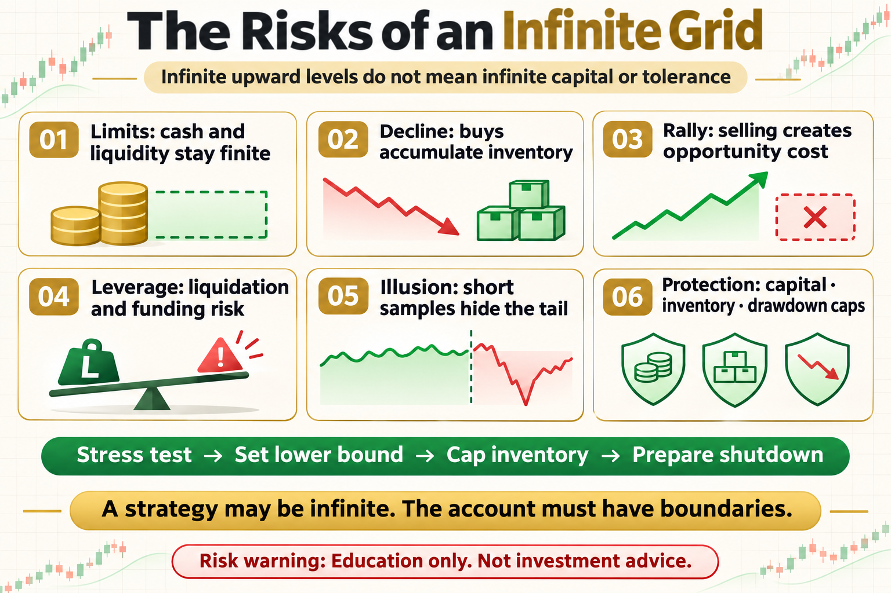

# The Risks of an Infinite Grid

“Infinite grid” sounds like unlimited profit. In practice, it usually means there is no fixed upper endpoint. It does not mean capital is unlimited, risk can be absorbed forever, or a decline cannot trap the position.

This article does not offer a magic parameter. It answers three practical questions: what the tool measures, where it may work, and how risk should be written into the rule.

## 1. Infinite Does Not Mean Risk-Free

The grid may keep adding sell levels upward, but cash, inventory, and liquidity remain finite. The lower boundary, position size, and shutdown mechanism still determine the outcome.

## 2. Downtrends Still Accumulate Inventory

As price falls, buy orders keep filling and cash turns into the asset. Without a maximum position or lower exit, the system holds the most risk when the market is weakest.

## 3. Rallies Create Opportunity Cost

During a fast rally, the grid keeps selling and inventory shrinks. It may book many small gains while underperforming simple holding by a wide margin.

## 4. Leverage Changes the Risk

A spot grid faces unrealized loss and opportunity cost. A leveraged grid adds liquidation, funding, and margin risk, so a position that could have waited may be forcibly closed.

## 5. Common Backtest Illusions

Short samples, omitted unrealized P&L, missing stress periods, and fills at closing prices can make an infinite grid look too stable. Test total equity under severe scenarios.

## 6. Boundaries You Still Need

Set maximum capital, maximum inventory, account drawdown limits, fault shutdown, manual takeover, and a lower price boundary. The name may be infinite; the risk budget cannot be.

## The Deeper Principle: An Indicator Is Not an Edge by Itself

An indicator is a transformation of price, volatility, or trading data. A durable process needs a clear hypothesis, repeatable execution, realistic costs, and controlled risk. Every attractive signal should be tested across regimes, out of sample, and in a small live or simulated environment.

## What an Ordinary Beginner Should Do

- Write the rule in one unambiguous sentence.
- Validate with spot exposure or simulation before considering leverage.
- Include fees, slippage, and imperfect fills.
- Limit risk per trade and record drawdown and losing streaks.
- Review which market regimes suit the strategy instead of changing parameters after every loss.

## Conclusion

A strategy may have no upper limit, but an account must always have boundaries.

The goal of learning strategies is not to find an indicator that never fails. It is to understand when it works, how it fails, and how the account survives until the next opportunity.

> Risk warning: This article is for trading education only and does not constitute investment advice. Digital assets are highly volatile. Historical backtests do not guarantee future returns, and live risk should be evaluated carefully.
