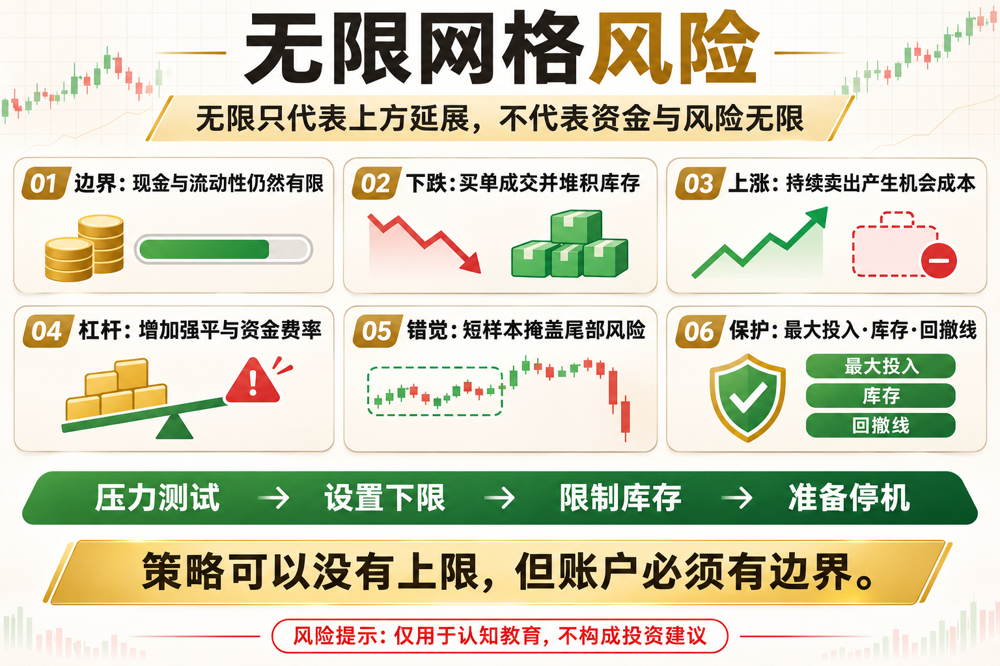

# 无限网格风险

“无限网格”听起来像没有上限、可以一直赚钱。实际上，无限通常只代表上方不设固定终点，并不代表资金无限、风险无限可承受，更不代表下跌时不会被套。

这篇文章不提供神奇参数，而是回答三个问题：这个工具在测量什么、它在什么环境可能有效、你怎样把风险写进规则。

## 一、无限不等于无风险

策略可以不断向上移动卖出层级，但可用资金、持仓和市场流动性都有边界。真正决定结果的，仍是下限、仓位与停止机制。

## 二、单边下跌仍会堆积库存

当价格持续下跌，买单不断成交，现金逐步变成资产。若没有最大仓位和下方退出，系统会在趋势最弱时持有最多风险。

## 三、上涨也有机会成本

价格快速上涨时，网格会持续卖出，最终持仓变少。它可能获得多次小利润，却显著跑输简单持有。

## 四、杠杆会改变风险性质

现货网格主要面对浮亏和机会成本；杠杆网格还会叠加强平、资金费率和保证金不足，原本可等待的仓位可能被强制结束。

## 五、回测中的常见错觉

短样本、忽略未实现盈亏、没有极端行情、用收盘价成交，都会让无限网格显得过于稳定。必须加入完整净值和压力测试。

## 六、必须设置的边界

设置最大投入、最大库存、账户回撤线、异常停机、人工接管和价格下限。名字可以叫无限，风险预算必须有限。

## 底层本质：指标不是优势本身

指标只是对价格、波动或成交数据的重新表达。真正的策略优势来自明确假设、可重复执行、合理成本和受控风险。任何看起来简单有效的信号，都要经历多阶段数据、样本外验证和小资金观察。

## 普通人该怎么做

- 先把规则写成一句没有歧义的话。
- 先用现货或模拟环境验证，不急着加杠杆。
- 把手续费、滑点和无法成交纳入结果。
- 限制单次风险，记录最大回撤与连续亏损。
- 定期复盘策略适用的市场状态，而不是亏损后临时改参数。

## 结语

策略可以没有上限，但账户必须有边界。

策略学习的目标，不是找到永不失效的指标，而是理解它何时有效、何时会受伤，以及账户如何活到下一次机会。

> 风险提示：本文仅用于交易认知与技术教育，不构成任何投资建议。数字资产波动较大，历史回测不代表未来收益，实盘前应充分评估风险。
