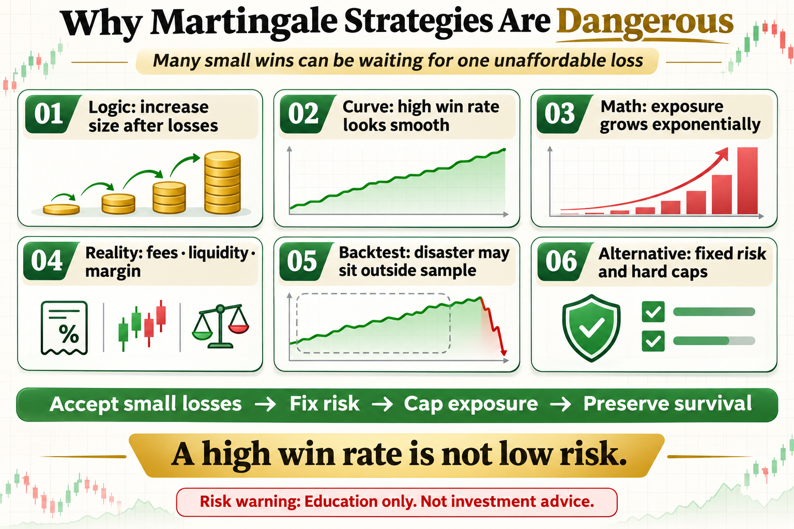

# Why Martingale Strategies Are Dangerous

Martingale is attractive because it wins often. After every loss, the position grows, and one rebound seems able to recover everything. The hidden price is exchanging many smooth small wins for one loss the account may not survive.

This article does not offer a magic parameter. It answers three practical questions: what the tool measures, where it may work, and how risk should be written into the rule.

## 1. The Mathematics of Martingale

The classic rule doubles after each loss. A starting unit of 1 becomes 2, 4, 8, and 16 after consecutive losses. Exposure grows exponentially, while account capital is finite.

## 2. High Win Rate Creates False Safety

Small rebounds happen often, so the equity curve may look smooth for a long time. Smoothness does not mean low risk; it may only mean the tail loss has not arrived yet.

## 3. Losing Streaks Eventually Appear

Any loss sequence with nonzero probability can occur when enough trades are taken. You do not know when it arrives, but the design must assume that it will.

## 4. Live Trading Adds Friction

Fees, slippage, minimum order sizes, liquidity, and margin requirements make the next theoretical doubling harder. In an extreme move, capital may run out before the rebound arrives.

## 5. Why Backtests Often Look Excellent

Short samples, missing one-way markets, and unlimited simulated sizing push disaster outside the test window. One liquidation can erase years of prior gains.

## 6. Better Alternatives

Keep risk fixed instead of increasing it after losses. Cap additions and total exposure, use a hard invalidation point, diversify, and accept normal losing trades rather than demanding every cycle end positive.

## The Deeper Principle: An Indicator Is Not an Edge by Itself

An indicator is a transformation of price, volatility, or trading data. A durable process needs a clear hypothesis, repeatable execution, realistic costs, and controlled risk. Every attractive signal should be tested across regimes, out of sample, and in a small live or simulated environment.

## What an Ordinary Beginner Should Do

- Write the rule in one unambiguous sentence.
- Validate with spot exposure or simulation before considering leverage.
- Include fees, slippage, and imperfect fills.
- Limit risk per trade and record drawdown and losing streaks.
- Review which market regimes suit the strategy instead of changing parameters after every loss.

## Conclusion

A high win rate is not low risk; the real danger often sits inside the one trade you cannot afford to lose.

The goal of learning strategies is not to find an indicator that never fails. It is to understand when it works, how it fails, and how the account survives until the next opportunity.

> Risk warning: This article is for trading education only and does not constitute investment advice. Digital assets are highly volatile. Historical backtests do not guarantee future returns, and live risk should be evaluated carefully.
