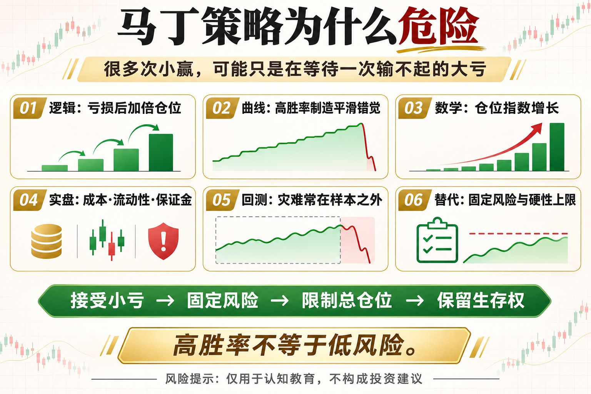

# 马丁策略为什么危险

马丁策略最迷人的地方，是它经常赢。每次亏损后加大仓位，只要下一次反弹，前面的亏损似乎都能拿回来。可它隐藏的代价，是用一次无法承受的大亏，交换很多次看起来稳定的小赢。

这篇文章不提供神奇参数，而是回答三个问题：这个工具在测量什么、它在什么环境可能有效、你怎样把风险写进规则。

## 一、马丁的数学逻辑

经典做法是在每次亏损后翻倍。若初始仓位为 1，连续亏损后会变成 2、4、8、16。仓位呈指数增长，而账户资金不是无限的。

## 二、高胜率制造安全错觉

大多数时候价格会有小反弹，因此策略净值可能长期平滑。平滑不代表风险小，只说明尾部损失还没有发生。

## 三、连续亏损一定会遇到

任何非零概率的亏损序列，只要交易次数足够多，就可能出现。你不知道它何时到来，但必须在设计时假设它会到来。

## 四、实盘还有额外摩擦

手续费、滑点、最小下单量、流动性和杠杆保证金，都会让理论上的下一次加仓更难执行。极端行情中，反弹可能来得比资金耗尽更晚。

## 五、为什么回测常常很好看

样本没有覆盖单边行情、回测期太短、仓位没有上限，都会把灾难推到样本之外。一次爆仓足以抹掉此前全部利润。

## 六、替代思路

固定风险而不是亏损后放大风险；设置最大加仓次数、总仓位和硬止损；用分散与小仓位接受正常亏损，不追求每轮都赢。

## 底层本质：指标不是优势本身

指标只是对价格、波动或成交数据的重新表达。真正的策略优势来自明确假设、可重复执行、合理成本和受控风险。任何看起来简单有效的信号，都要经历多阶段数据、样本外验证和小资金观察。

## 普通人该怎么做

- 先把规则写成一句没有歧义的话。
- 先用现货或模拟环境验证，不急着加杠杆。
- 把手续费、滑点和无法成交纳入结果。
- 限制单次风险，记录最大回撤与连续亏损。
- 定期复盘策略适用的市场状态，而不是亏损后临时改参数。

## 结语

高胜率不等于低风险，真正的风险往往藏在那一次输不起的交易里。

策略学习的目标，不是找到永不失效的指标，而是理解它何时有效、何时会受伤，以及账户如何活到下一次机会。

> 风险提示：本文仅用于交易认知与技术教育，不构成任何投资建议。数字资产波动较大，历史回测不代表未来收益，实盘前应充分评估风险。
