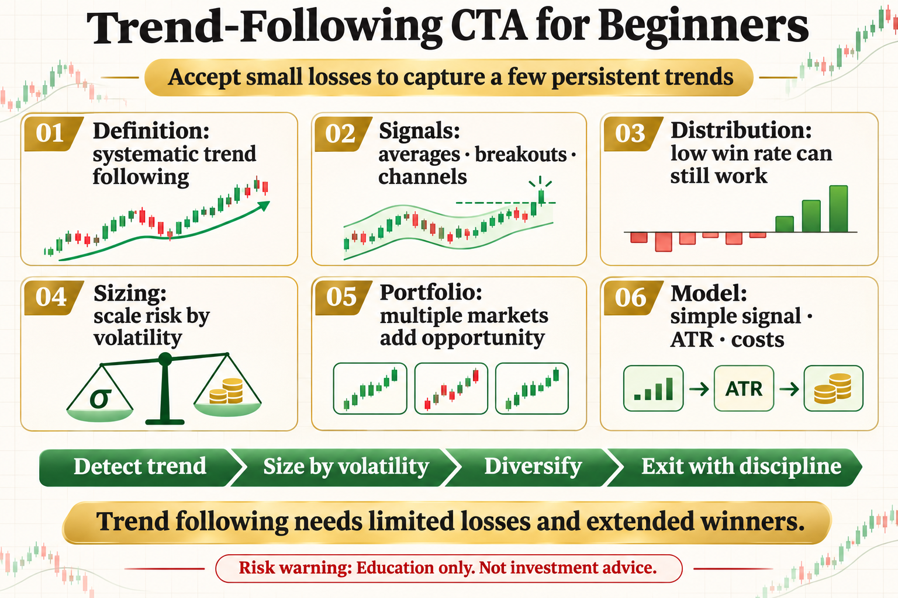

# Trend-Following CTA for Beginners

CTA may sound institutional, but its core idea is simple: detect trends with rules, follow them, and exit when they end. It does not need to be right often; it accepts small losses in exchange for a few large trends.

This article does not offer a magic parameter. It answers three practical questions: what the tool measures, where it may work, and how risk should be written into the rule.

## 1. What CTA Means

CTA originally means Commodity Trading Advisor and is commonly associated with systematic futures and trend following. Digital-asset traders can borrow its rules-based, multi-market, and risk-budgeting ideas.

## 2. Where Signals Come From

Common signals include moving averages, price breakouts, channels, and momentum rankings. Each asks the same question in a different way: is the trend strong enough to participate in?

## 3. Why Win Rate May Be Low

Trend systems take repeated small losses during choppy periods. Most profit may come from a few persistent moves, so win rate alone misrepresents the return distribution.

## 4. Sizing Matters More Than Entry

The same signal carries different risk on high- and low-volatility assets. Position sizes are often scaled by volatility, with risk caps for each market and the whole portfolio.

## 5. Why Multiple Markets Help

Trends do not appear everywhere at once. Diversifying across liquid markets increases opportunities, although correlations can rise sharply during stress.

## 6. A Minimal Beginner Model

Choose a few liquid assets, use a simple breakout or average signal, size by ATR or volatility, include fees and slippage, and evaluate portfolio drawdown and correlation.

## The Deeper Principle: An Indicator Is Not an Edge by Itself

An indicator is a transformation of price, volatility, or trading data. A durable process needs a clear hypothesis, repeatable execution, realistic costs, and controlled risk. Every attractive signal should be tested across regimes, out of sample, and in a small live or simulated environment.

## What an Ordinary Beginner Should Do

- Write the rule in one unambiguous sentence.
- Validate with spot exposure or simulation before considering leverage.
- Include fees, slippage, and imperfect fills.
- Limit risk per trade and record drawdown and losing streaks.
- Review which market regimes suit the strategy instead of changing parameters after every loss.

## Conclusion

Trend following does not rely on being right every time; it relies on limited losses and extended winners.

The goal of learning strategies is not to find an indicator that never fails. It is to understand when it works, how it fails, and how the account survives until the next opportunity.

> Risk warning: This article is for trading education only and does not constitute investment advice. Digital assets are highly volatile. Historical backtests do not guarantee future returns, and live risk should be evaluated carefully.
