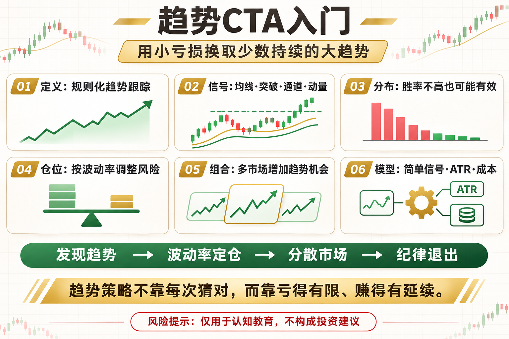

# 趋势CTA入门

CTA 听起来像机构专用名词，其核心却很朴素：用规则发现趋势、跟随趋势，并在趋势结束时退出。它不要求每次判断正确，而是用小亏损换取少数大趋势。

这篇文章不提供神奇参数，而是回答三个问题：这个工具在测量什么、它在什么环境可能有效、你怎样把风险写进规则。

## 一、CTA是什么

CTA 原本指商品交易顾问，实践中常与系统化期货和趋势跟踪联系在一起。数字资产里，可以借用其规则化、多市场和风险预算思想。

## 二、信号从哪里来

常见信号包括均线、价格突破、通道和动量排名。不同信号表达方式不同，但都在回答同一个问题：趋势是否已经强到值得参与。

## 三、为什么胜率不一定高

趋势策略会在震荡期反复小亏，真正收益往往来自少数持续行情。只盯胜率，会误判这类策略的分布特征。

## 四、仓位比入场更重要

同样的信号放在高波动与低波动资产上，风险完全不同。常见做法是按波动率调整仓位，并给单市场和组合设置风险上限。

## 五、多市场的意义

趋势不会同时出现在所有市场。分散多个流动性较好的品种，可以增加捕捉趋势的机会，但相关性在危机时也可能突然上升。

## 六、新手的最小模型

选择少量高流动性资产，用简单突破或均线信号，按 ATR 或波动率控制仓位，加入费用和滑点，再评估组合回撤与相关性。

## 底层本质：指标不是优势本身

指标只是对价格、波动或成交数据的重新表达。真正的策略优势来自明确假设、可重复执行、合理成本和受控风险。任何看起来简单有效的信号，都要经历多阶段数据、样本外验证和小资金观察。

## 普通人该怎么做

- 先把规则写成一句没有歧义的话。
- 先用现货或模拟环境验证，不急着加杠杆。
- 把手续费、滑点和无法成交纳入结果。
- 限制单次风险，记录最大回撤与连续亏损。
- 定期复盘策略适用的市场状态，而不是亏损后临时改参数。

## 结语

趋势策略不靠每次猜对，而靠亏得有限、赚得有延续。

策略学习的目标，不是找到永不失效的指标，而是理解它何时有效、何时会受伤，以及账户如何活到下一次机会。

> 风险提示：本文仅用于交易认知与技术教育，不构成任何投资建议。数字资产波动较大，历史回测不代表未来收益，实盘前应充分评估风险。
