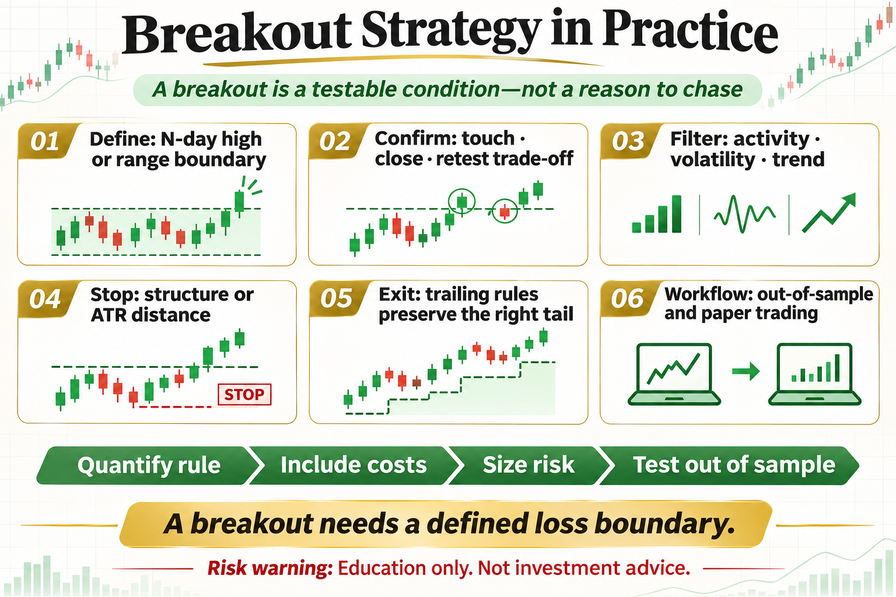

# Breakout Strategy in Practice

Breakout logic is direct: when price leaves an old range, a new supply-demand imbalance may be forming. But not every new high is an opportunity. False breaks, execution cost, and position size often matter more than the signal itself.

This article does not offer a magic parameter. It answers three practical questions: what the tool measures, where it may work, and how risk should be written into the rule.

## 1. Define a Breakout First

A breakout may mean a close above the prior N-day high, a move beyond a range, or a threshold measured in volatility. The definition must be computable rather than explained by eye afterward.

## 2. The Entry Confirmation Trade-off

Entering on an intraday touch is faster but catches more false breaks. Waiting for the close confirms more but pays a higher price. A retest entry can help, but strong trends may never return.

## 3. Filtering Low-Quality Breakouts

Volume activity, volatility expansion, trend direction, and range duration can help. More filters also mean fewer trades and greater overfitting risk, so out-of-sample testing is essential.

## 4. Where to Put the Stop

Common choices include inside the old range, below a recent swing, or an ATR-based distance. Tight stops are vulnerable to noise; wider stops require smaller positions.

## 5. Exits Drive Much of the Return

Options include trailing stops, opposite channel breaks, time exits, and partial profits. A few large moves often create the strategy edge, so taking profit too early can remove the positive tail.

## 6. A Minimal Practical Workflow

Test a 20-day high breakout on daily data, execute on the next bar, size and stop with ATR, include fees and slippage, then run out-of-sample and paper-trading checks.

## The Deeper Principle: An Indicator Is Not an Edge by Itself

An indicator is a transformation of price, volatility, or trading data. A durable process needs a clear hypothesis, repeatable execution, realistic costs, and controlled risk. Every attractive signal should be tested across regimes, out of sample, and in a small live or simulated environment.

## What an Ordinary Beginner Should Do

- Write the rule in one unambiguous sentence.
- Validate with spot exposure or simulation before considering leverage.
- Include fees, slippage, and imperfect fills.
- Limit risk per trade and record drawdown and losing streaks.
- Review which market regimes suit the strategy instead of changing parameters after every loss.

## Conclusion

A breakout is not an excuse to chase price; it is a testable condition with a defined loss boundary.

The goal of learning strategies is not to find an indicator that never fails. It is to understand when it works, how it fails, and how the account survives until the next opportunity.

> Risk warning: This article is for trading education only and does not constitute investment advice. Digital assets are highly volatile. Historical backtests do not guarantee future returns, and live risk should be evaluated carefully.
