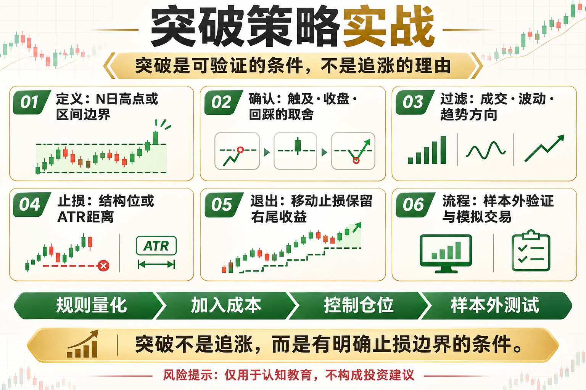

# 突破策略实战

突破策略的逻辑很直接：价格离开过去的区间，可能意味着新的供需失衡。但图上每一个新高都不是机会。假突破、追价成本和错误仓位，往往比信号本身更决定结果。

这篇文章不提供神奇参数，而是回答三个问题：这个工具在测量什么、它在什么环境可能有效、你怎样把风险写进规则。

## 一、先定义什么叫突破

可以定义为收盘价突破过去 N 日最高价、突破区间边界，或突破后超过一定波动幅度。定义必须可计算，不能等看到图后凭感觉解释。

## 二、入场确认的取舍

盘中触及就入场更快，但假突破更多；等待收盘确认更稳，却可能付出更高价格。也可以等待突破后回踩，但有些强趋势不会回头。

## 三、过滤低质量突破

可结合成交活跃度、波动扩张、趋势方向和区间持续时间。过滤条件越多，交易越少，也越容易过拟合，必须做样本外验证。

## 四、止损放在哪里

常见位置包括突破位内侧、最近摆动低点或基于 ATR 的距离。止损太近容易被噪声扫掉，太远则需要更小仓位。

## 五、退出决定大部分收益

可以使用移动止损、通道反向突破、时间退出或分批止盈。突破策略的价值常来自少数大行情，过早止盈会切断右尾收益。

## 六、一套最小实战流程

用日线数据测试 20 日高点突破，下一根 K 线成交，ATR 控制仓位与止损，加入手续费和滑点，再做样本外测试与纸面交易。

## 底层本质：指标不是优势本身

指标只是对价格、波动或成交数据的重新表达。真正的策略优势来自明确假设、可重复执行、合理成本和受控风险。任何看起来简单有效的信号，都要经历多阶段数据、样本外验证和小资金观察。

## 普通人该怎么做

- 先把规则写成一句没有歧义的话。
- 先用现货或模拟环境验证，不急着加杠杆。
- 把手续费、滑点和无法成交纳入结果。
- 限制单次风险，记录最大回撤与连续亏损。
- 定期复盘策略适用的市场状态，而不是亏损后临时改参数。

## 结语

突破不是追涨的理由，而是一套可以验证、可以止损的条件。

策略学习的目标，不是找到永不失效的指标，而是理解它何时有效、何时会受伤，以及账户如何活到下一次机会。

> 风险提示：本文仅用于交易认知与技术教育，不构成任何投资建议。数字资产波动较大，历史回测不代表未来收益，实盘前应充分评估风险。
